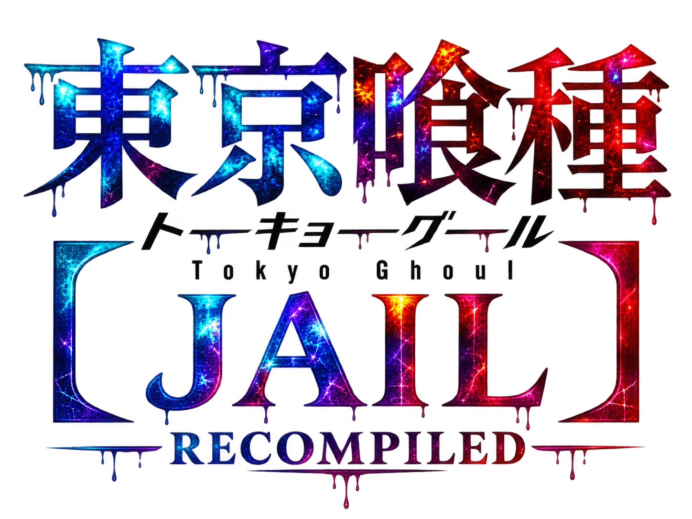
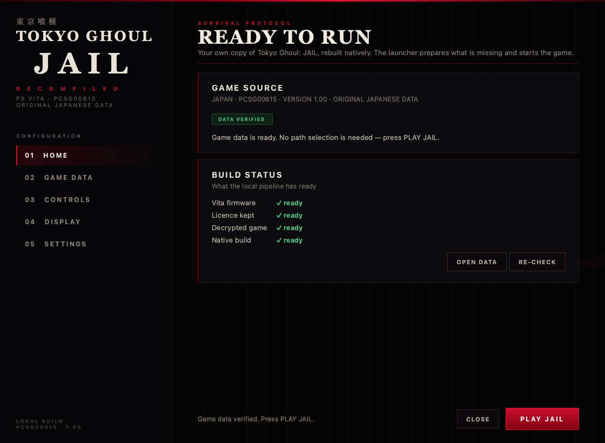
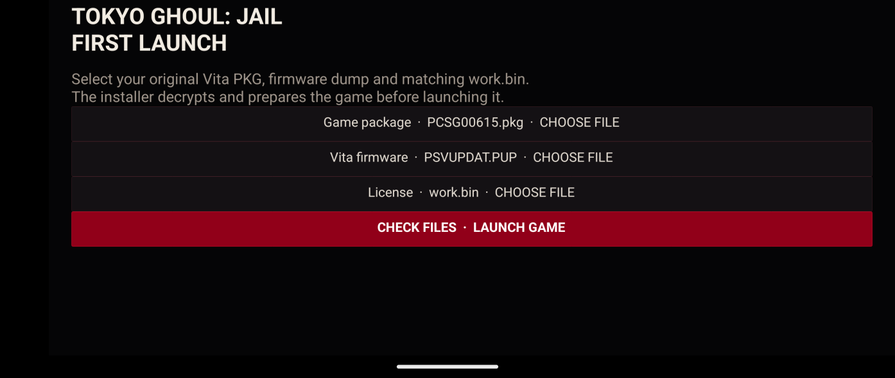
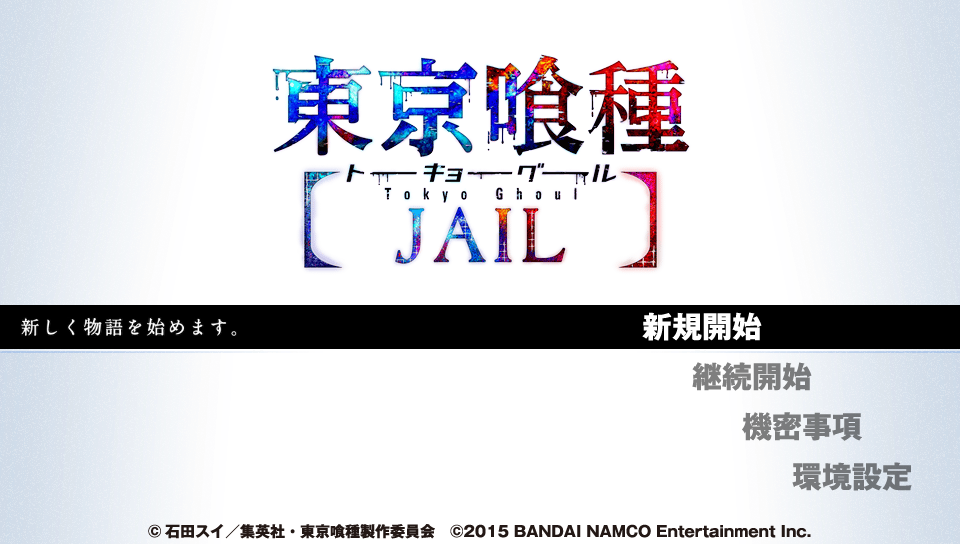
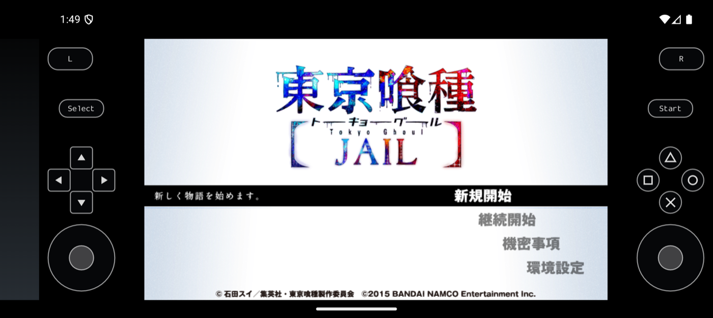
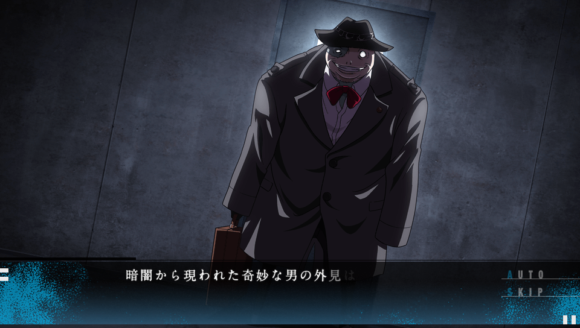
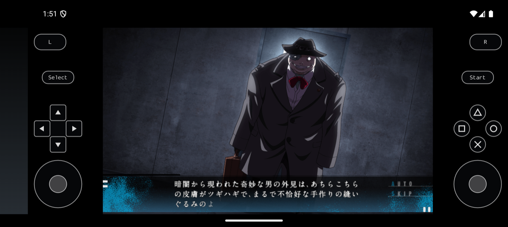
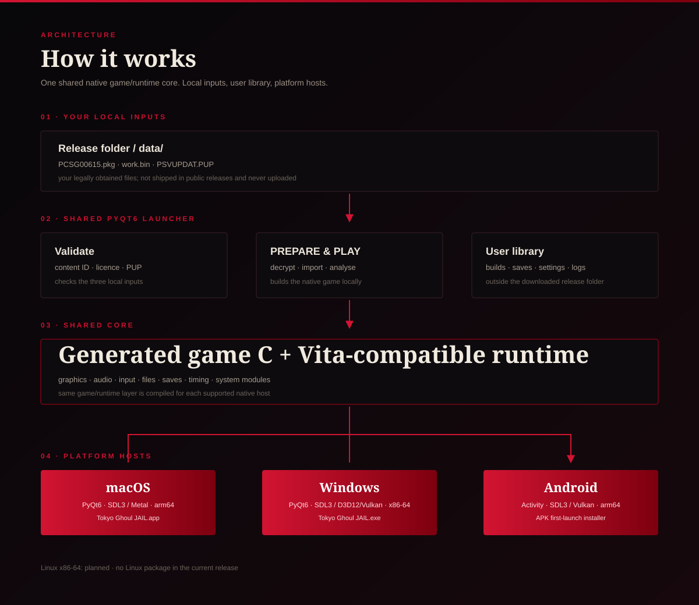

<div align="center">



# Tokyo Ghoul: JAIL — Recompiled

**The Japanese PS Vita release, recompiled for macOS Apple Silicon and Android arm64.**


[Platforms](#platforms) · [Screenshots](#screenshots) · [macOS](#macos) · [Android](#android) · [How it works](#how-it-works) · [FAQ](#faq)

</div>

**JAIL Recompiled** is a native recompilation of **Tokyo Ghoul: JAIL**
(`PCSG00615`, Japan, version 1.00). The game's ARMv7 code is translated ahead
of time into C and compiled together with a Vita-compatible runtime. It is not
a rewritten game engine or a conventional emulator.

> [!IMPORTANT]
> **Bring your own game.** No game files, firmware, licences or translation
> assets are included. You need your own legally obtained PKG, matching
> licence and Vita firmware. Release builds contain only the app: the game
> data is still yours to provide and is never uploaded.

## Platforms

| Platform | Status | Launcher | Graphics | Input |
| :--- | :--- | :--- | :--- | :--- |
| **macOS** Apple Silicon | ✅ Playable start to finish | PyQt6 desktop launcher | SDL3 · Metal | Keyboard, gamepad |
| **Android** arm64 | ✅ Playable start to finish (verified on a Galaxy S25 Ultra · Android 17) | Built-in PKG installer | SDL3 · Vulkan | Touch controls, gamepad |
| **Windows** | 🕓 Planned | — | — | — |
| **Linux** | 🕓 Planned | — | — | — |

Both ports run the same recompiled game code and the same runtime, so saves
and game behaviour match. Windows and Linux support is planned for a later
stage.

## Screenshots

<table>
  <tr>
    <th width="50%">macOS</th>
    <th width="50%">Android</th>
  </tr>
  <tr>
    <td><a href="docs/images/launcher-home.png"></a></td>
    <td><a href="docs/images/android-launcher.png"></a></td>
  </tr>
  <tr>
    <td align="center" colspan="2"><b>Launcher</b></td>
  </tr>
  <tr>
    <td><a href="docs/images/game-menu-jp.png"></a></td>
    <td><a href="docs/images/android-menu-gamepad.png"></a></td>
  </tr>
  <tr>
    <td align="center" colspan="2"><b>Main menu</b></td>
  </tr>
  <tr>
    <td><a href="docs/images/game-story-jp.png"></a></td>
    <td><a href="docs/images/android-story-gamepad.png"></a></td>
  </tr>
  <tr>
    <td align="center" colspan="2"><b>In game</b></td>
  </tr>
</table>

Screenshots come from the original Japanese release running in local builds.

## What you need

| File | What it is |
| :--- | :--- |
| `PCSG00615.pkg` | Your Japanese 1.00 game package (original filename is fine) |
| `work.bin` or `.rif` | The matching 512-byte licence for that package |
| `PSVUPDAT.PUP` | Sony's Vita firmware update; system libraries are rebuilt from it |

The PKG does not contain the firmware, and the firmware does not contain the
game: all three are needed.

## macOS

### Requirements

- Mac with Apple Silicon, macOS 12 or newer;
- Apple Command Line Tools (`xcode-select --install`);
- Python 3 with `venv`;
- [Homebrew](https://brew.sh) — recommended, used to install missing `cmake`
  and `ninja`;
- about 5 GB of free disk space for the decrypted game and the build.

The launcher installs everything else on first run: a Python environment in
`nativ/.venv` with PyQt6, PyCryptodome and Capstone, and the pinned native
toolchain (SDL3, SPIRV-Cross, FFmpeg).

### Install and play

1. Put your files in `data/`:

   ```text
   data/
   ├── PCSG00615.pkg
   ├── work.bin
   └── PSVUPDAT.PUP
   ```

2. Start the launcher:

   - from the repository: `./JAIL-PyQt.command`;
   - from the release: open **Tokyo Ghoul JAIL.app**.

   Both run the same PyQt6 launcher. The packaged app keeps your files, logs
   and builds in `~/Library/Application Support/TokyoGhoulJAIL/JAIL`.

3. Press **PREPARE & PLAY**. The first run decrypts your copy, recompiles the
   game and builds it, which takes a while. After that the button becomes
   **PLAY JAIL** and the game starts right away.

If your files are elsewhere, use **Browse** in the launcher: it checks the
files and copies them into the launcher's data folder (`data/` in the
repository, or `~/Library/Application Support/TokyoGhoulJAIL/JAIL/data` in the
packaged app).

Shader, trophy and input notifications are off by default on macOS and
Windows. Turn them back on in **Display → On-screen messages**, or in the game
under **F10 → Game → On-screen messages**.

### Launcher pages

| Page | What it does |
| :--- | :--- |
| **Home** | File check, build status, Prepare & Play / Play JAIL |
| **Game Data** | PKG, licence and firmware status; Browse and re-check |
| **Controls** | Keyboard bindings |
| **Display** | Resolution, frame rate, picture fit, aspect ratio, volume, on-screen messages |
| **Settings** | Optional system log, local folders, licence notices |

<details>
<summary><b>Command-line build</b></summary>

The launcher runs these same steps. With the files in `data/`:

```sh
src/tools/prepare_jail.sh
```

or step by step:

```sh
cd nativ
./vitarecomp firmware   ../data/PSVUPDAT.PUP
./vitarecomp licenses   import ../data/work.bin
./vitarecomp add        ../data/PCSG00615.pkg --license ../data/work.bin --no-build
./vitarecomp analyze    PCSG00615
./vitarecomp recompile  PCSG00615
./vitarecomp build      PCSG00615
./vitarecomp run        PCSG00615
```

</details>

## Android

The Android APK is built on a Mac (or Linux) from the same sources. The
recompiled game code comes from the macOS build above, so **build the game on
macOS first**.

**Hardware status (19 November 2026):** the game was installed and played
through to the end on a **Samsung Galaxy S25 Ultra (SM-S938B, Android 17,
arm64)**: story scenes, menus and the touch/controller input all work, and the
game is fully completable. The same build runs on the Android emulator. Two
device-specific details came out of that test:

- Android 17's libc aborts on a destroyed mutex inside Samsung's vendor display
  allocator when the system renderer draws the app window through Vulkan. The
  manifest therefore disables window hardware acceleration for the app; the
  game itself still renders through its own SDL Vulkan surface.
- The APK validates the selected PKG before decrypting it: the container magic,
  the PFS signatures and the matching `work.bin` are checked, so a wrong file
  or licence is reported instead of crashing the runtime.

### Requirements

- everything from the macOS section, with a completed game build;
- [Android Studio](https://developer.android.com/studio) or the command-line
  SDK with:
  - Android SDK Platform 35, Platform-Tools and Build-Tools;
  - NDK `28.2.13676358`;
  - CMake `3.31.6`;
- JDK 17 (`brew install openjdk@17`);
- an arm64 Android 10+ phone, or an emulator, with Vulkan.

The Gradle wrapper is included. SDL3 3.4.10 and FFmpeg 7.1.1 are downloaded and
built by the scripts.

### Build the APK

```sh
cd android
scripts/build_android.sh               # with video playback
scripts/build_android.sh --no-ffmpeg   # faster build, no video
```

The APK appears in `android/app/build/outputs/apk/debug/app-debug.apk`.

### Release build (signed)

Release APKs are signed with a key kept outside the repository, in
`data/keystore/` (ignored by Git). Create it once and keep it safe: every
update must carry the same signature.

```sh
cd android
scripts/release_apk.sh v0.1.2
```

The script builds `assembleRelease`, verifies the signature, stages
`nativ/build/release/v0.1.2/JAIL-v0.1.2-android-arm64.apk` and writes its
SHA-256. `versionCode` and `versionName` live in `android/app/build.gradle`.

An APK signed with a different key (for example an older debug build) cannot
be updated in place: uninstall it once, then install the release build.

### Verification

```sh
cd android
tests/run.sh
```

builds synthetic PKGs and runs the Android decryptor against them: the good
package, a licence from another copy, a truncated download, a corrupted
payload, a file that is not a PKG, a failed reinstall that must keep the
previous `app0` and saves, and the free-space message. `.github/workflows/verify.yml`
runs the same checks plus the Python reference self-tests on every push;
`release-checksums.yml` regenerates `SHA256SUMS` from the uploaded release
assets.

A GitHub-hosted runner cannot build the APK itself: the recompiled game C is
private. `.github/workflows/android-build.yml` is a manual job for a
self-hosted Mac that has the local game build and `data/keystore/`.

### Install

With the phone connected over USB (debugging enabled) or an emulator running:

```sh
cd android
scripts/install_android.sh
```

This installs the APK. For development it also pushes an already prepared
`app0` and the runtime inputs over ADB, which skips the on-device installer.

### First launch

On the first launch the app asks for three files:

| Choice | File |
| :--- | :--- |
| Game package | your retail `PCSG00615.pkg` (about 1 GB) |
| Vita firmware | `PSVUPDAT.PUP` |
| Licence | `work.bin` |

The app decrypts the PKG on the phone itself and writes `app0` into its
private storage. The recompiled game image (`game.img`) and the small Vita
runtime modules (`libc.img`, `libgxm_es4.img`, `libgpu_es4.img`,
`libfios2.img`, `libpvf.img`, `libult.img`, `libSceFt2.img`) are already
inside the APK and are installed automatically.

The first preparation needs about 3 GB of free space and takes a few minutes.
After it finishes the game starts directly, and the copied PKG is removed.
`scripts/install_android.sh` remains available for developers who already
have a locally decrypted `app0` and prefer the ADB route.

### Game data and support

After installation the launcher becomes a small service screen. Long-press the
app icon and choose **Game data** to open it (or run
`adb shell am start -n dev.ch1ppy.jail/.MainActivity --ez install true`).

From there you can:

- launch the game;
- **reinstall the game data** — saves and settings are kept;
- **share a diagnostic log** with the device model, Android version and the
  tail of `runtime.log`.

The launcher checks free space before copying and decrypting and reports how
much is missing instead of failing halfway through.

### Controls

On-screen buttons are visible from launch and hide when a gamepad is used.
A Bluetooth or USB gamepad works out of the box.

### Tips

- On the emulator, start it with a hardware GPU for full speed:

  ```sh
  $ANDROID_HOME/emulator/emulator -avd <name> -gpu host
  ```

- The game was played through to the end on the Galaxy S25 Ultra; battery use
  has not been measured yet.

## How it works

<p align="center">
  
</p>

1. **Your files** — the PKG, licence and firmware stay on your machine.
2. **Prepare** — the package is decrypted (by the macOS launcher during setup,
   or by the Android app on first launch) and the Vita system libraries are
   rebuilt from your firmware.
3. **Recompile** — the game's ARMv7 code is analysed and translated to C, one
   function at a time.
4. **Build** — the generated C is compiled together with a Vita-compatible
   runtime that provides graphics, audio, input, files, saves and timing.
5. **Play** — the result is a native macOS app or Android APK. There is no
   emulator and no JIT at runtime.

The original game assets are read from your decrypted copy; nothing from the
game is stored in this repository.

## Troubleshooting

| Problem | Fix |
| :--- | :--- |
| Play button disabled | Open **Game Data** and check the three badges; the files must be the Japanese 1.00 release |
| `No module named 'Crypto'` | Run `./JAIL-PyQt.command` again to finish the setup |
| Very slow rendering on macOS | The native toolchain is missing; run the launcher again so it can build it |
| Android: `libSDL3.so not found` | Rebuild with `scripts/build_android.sh` |
| Android: black screen after start | Run the in-app installer again (or delete the app data and reinstall) |
| Android: not enough free space | Free at least 3 GB for the first preparation, then run the installer again |
| Android: `work.bin does not match this PKG` | Use the licence that belongs to this exact package; a licence from another edition or region is rejected |
| Android: `the selected file is not a Vita PKG` | Select the retail `.pkg` itself, not a zip, ISO or extracted folder |
| Want a fresh start | Delete `nativ/dump/` to decrypt and rebuild from scratch |

To report a problem, enable **Settings → Write system log** and attach
`logs/launcher.log`. On Android: `adb logcat -s JailAndroid SDL`.

## FAQ

**Does this include the game or firmware?**
No. You provide your own game, licence and firmware.

**Can I download a ready-made app or APK?**
No. Everything is built locally from your own files. Do not share built APKs
or apps: they contain code derived from the game.

**Is the game translated?**
No. The build uses the original Japanese release.

**Will another region or update work?**
No. This targets the Japanese 1.00 release only.

## Star history

<a href="https://star-history.com/#ch1ppyone/jail-recomp&Date">
  
</a>

## Repository layout

```text
src/launcher/   macOS launcher
android/        Android app and build scripts
nativ/          recompiler, runtime and build pipeline (shared)
packs/          game-specific configuration
src/tools/      helper tools
docs/images/    screenshots and diagrams
data/           your files — not tracked by Git
```

## Credits

- **[Luufen/nativ](https://github.com/Luufen/nativ)** (GPL-2.0-or-later) —
  Vita runtime, static recompiler, decryption pipeline and launcher tooling.
  Included in `nativ/`.
- **[Project Nativ](https://github.com/TheLostPantheon/nativ)** — community
  project that Luufen/nativ is forked from; original runtime and tooling.
- **[PersonaDancingRecomp](https://github.com/Ecstatic-Magician/PersonaDancingRecomp)**
  by Ecstatic-Magician — Vita runtime work merged into the nativ lineage.
- **[Vita3K](https://github.com/Vita3K/Vita3K)** — Vita hardware and
  system-module reference; `SceSelf`, PKG, PUP and NID handling in
  `nativ/decrypt/`.
- **[VitaSDK / vita-headers](https://github.com/vitasdk/vita-headers)** — NID
  database used to name imported functions.
- **[pkg2zip](https://github.com/mmozeiko/pkg2zip)** — PKG container format
  reference.
- **[psvpfstools](https://github.com/motoharu-gosuto/psvpfstools)** and
  **[Vita3K psvpfsparser](https://github.com/Vita3K/psvpfsparser)** — PFS
  decryption reference.
- **[TeamMolecule sceutils](https://github.com/TeamMolecule/sceutils)** — key
  values and SELF/PUP handling reference.
- **[SDL3](https://github.com/libsdl-org/SDL)** — window, input, audio and GPU
  platform layer on macOS and Android.
- **[Dear ImGui](https://github.com/ocornut/imgui)** (MIT) — runtime overlay.
- **[AMD FidelityFX SDK](https://github.com/GPUOpen-LibrariesAndSDKs/FidelityFX-SDK)**
  (MIT) — FSR 3.1 upscaler shaders.
- **[FFmpeg](https://ffmpeg.org)** (LGPL-2.1-or-later) — H.264 and AAC decoding.
- **[SPIRV-Cross](https://github.com/KhronosGroup/SPIRV-Cross)** (Apache-2.0) —
  shader translation on macOS.
- **[Capstone](https://github.com/capstone-engine/capstone)** (BSD-3-Clause) —
  ARM disassembly in the analysis tools.
- **[PyCryptodome](https://www.pycryptodome.org)** (BSD-2-Clause; parts public
  domain) — AES and key handling in the local pipeline.
- **[PyQt6](https://www.riverbankcomputing.com/software/pyqt/)** (GPL-3.0) —
  launcher interface.
- **[Kenney Input Prompts](https://kenney.nl/assets/input-prompts)** (CC0 1.0) —
  controller button icons.
- **[Outfit font](https://fonts.google.com/specimen/Outfit)** (SIL OFL 1.1) —
  bundled UI font.

Project-specific work — JAIL title pack, launchers, macOS and Android ports,
build tooling and documentation: **[ch1ppyone](https://github.com/ch1ppyone)**.

Full component terms are in `LICENSE`, `nativ/LICENSE`, `nativ/THIRD_PARTY.md`
and alongside the vendored third-party sources.

## Legal

Tokyo Ghoul: JAIL © 石田スイ／集英社・東京喰種製作委員会
©2015 BANDAI NAMCO Entertainment Inc. All rights to the game, its characters
and assets belong to their respective owners.

This independent project is not affiliated with, endorsed by or sponsored by
Bandai Namco Entertainment, Sony Interactive Entertainment, Shueisha or any
other rights holder.

No game packages, firmware, keys, licences, decrypted executables, generated
game builds or modified game archives are included. Use only files you are
legally entitled to use. Do not publish private inputs or derived game content.

---

<div align="center">
<sub>Tokyo Ghoul: JAIL — Recompiled · by <a href="https://github.com/ch1ppyone">ch1ppyone</a></sub>
</div>
